# OmniEats — System Class Diagram

TAR UMT AMCS2194 · Chapter 2 material · matches the implemented code.
One representative class per area is shown per layer; every controller/service/model
in the codebase follows the same pattern.

```mermaid
classDiagram
    %% ------------------- CORE -------------------
    class Router {
        +get(path, handler, middleware)
        +post(path, handler, middleware)
        -dispatch(method, uri)
    }

    %% ------------------- MIDDLEWARE -------------------
    class AuthMiddleware {
        +apply(guard)
        +homeFor(user) string
    }
    class CsrfMiddleware {
        +verify()
    }

    %% ------------------- VALIDATORS -------------------
    class Validator {
        #errors
        +required(...fields)
        +email(field)
        +minLength(field, n)
        +maxLength(field, n)
        +matches(field, confirm)
        +phone(field)
        +positiveNumber(field)
        +nonNegativeNumber(field)
        +inList(field, allowed)
        +requiredIf(field, other, values)
        +passwordStrength(field)
        +fails() bool
        +firstError() string
    }
    class RegisterValidator
    class UserCreateValidator
    class UserUpdateValidator
    class ProfileValidator
    class PasswordValidator
    class RestaurantValidator
    class BranchValidator
    class CategoryValidator
    class FoodItemValidator
    class PlanValidator
    Validator <|-- RegisterValidator
    Validator <|-- UserCreateValidator
    Validator <|-- UserUpdateValidator
    Validator <|-- ProfileValidator
    Validator <|-- PasswordValidator
    Validator <|-- RestaurantValidator
    Validator <|-- BranchValidator
    Validator <|-- CategoryValidator
    Validator <|-- FoodItemValidator
    Validator <|-- PlanValidator

    %% ------------------- MODELS -------------------
    class Model {
        #db() PDO
    }
    class User {
        +find(id) +findByEmail(email) +search(q, role, status)
        +create(...) +update(...) +setRoles(...) +setTenant(...) +setStatus(...)
    }
    class Restaurant {
        +find(id) +publicListing(q, open) +adminListing(q, status)
        +create(...) +update(...) +setStatus(...) +setOpen(...)
    }
    class Branch
    class Category
    class FoodItem
    class Plan
    class Subscription {
        +activeForRestaurant(rid) +expireOverdue() +create(...) +extend(...) +cancel(...)
    }
    class Cart
    class CartItem
    class Order {
        +nextOrderNo() +create(...) +listForCustomer(cid) +listForRestaurant(rid, status)
    }
    class OrderItem
    class OrderStatusHistory
    class Payment
    class Fulfilment
    class ActivityLog
    Model <|-- User
    Model <|-- Restaurant
    Model <|-- Branch
    Model <|-- Category
    Model <|-- FoodItem
    Model <|-- Plan
    Model <|-- Subscription
    Model <|-- Cart
    Model <|-- CartItem
    Model <|-- Order
    Model <|-- OrderItem
    Model <|-- OrderStatusHistory
    Model <|-- Payment
    Model <|-- Fulfilment
    Model <|-- ActivityLog

    %% ------------------- SERVICES (business rules) -------------------
    class AuthService {
        +attempt(email, pw) +loginUser(user) +logout() +user() +hasRole(...)
    }
    class UserService {
        +register(data, role) +adminCreate(data) +adminUpdate(id, data, admin)
        +toggleStatus(id, admin) +updateProfile(id, data) +changePassword(id, data)
    }
    class RestaurantService {
        +registerForOwner(...) +updateProfile(...) +toggleOpen(id) +setApproval(id, status)
    }
    class BranchService {
        +create(rid, data) +update(rid, id, data) +delete(rid, id)
    }
    class CategoryService
    class FoodItemService
    class SubscriptionService {
        +syncExpiry() +quota(rid) +enforceForBranch(rid) +enforceForFoodItem(rid)
        +subscribe(rid, planId) +cancel(rid)
    }
    class PlanService
    class CartService {
        +addItem(cid, foodId, qty) +updateQuantity(...) +removeItem(...) +clear(...) +contents(cid)
    }
    class OrderService {
        +checkout(cid, data) +transition(oid, status, actor, note) +transitionBySystem(...)
    }
    class PaymentService {
        +pay(oid, cid, method, simulateDecline) +markVoid(pid, tenant) +delete(pid, tenant)
    }
    class FulfilmentService {
        +updateStatus(fid, tenant, status) +cancelForOrder(oid)
    }
    class UploadService {
        +store(file, subdir) array
    }

    %% ------------------- CONTROLLERS (thin) -------------------
    class HomeController
    class AuthController
    class RegisterController
    class ProfileController
    class RestaurantController
    class FoodController
    class CartController
    class CheckoutController
    class OrderController
    class AdminUserController
    class AdminRestaurantController
    class AdminPlanController
    class AdminSubscriptionController
    class AdminActivityController
    class OwnerRestaurantController
    class OwnerBranchController
    class OwnerCategoryController
    class OwnerFoodItemController
    class OwnerSubscriptionController
    class OwnerOrderController
    class OwnerPaymentController
    class OwnerFulfilmentController

    %% ------------------- RELATIONSHIPS -------------------
    HomeController ..> Restaurant
    AuthController ..> AuthService
    RegisterController ..> UserService
    ProfileController ..> UserService
    RestaurantController ..> Restaurant
    FoodController ..> FoodItem
    CartController ..> CartService
    CheckoutController ..> OrderService
    OrderController ..> OrderService
    OrderController ..> PaymentService
    AdminUserController ..> UserService
    AdminRestaurantController ..> RestaurantService
    AdminPlanController ..> PlanService
    AdminSubscriptionController ..> SubscriptionService
    AdminActivityController ..> ActivityLog
    OwnerRestaurantController ..> RestaurantService
    OwnerBranchController ..> BranchService
    OwnerCategoryController ..> CategoryService
    OwnerFoodItemController ..> FoodItemService
    OwnerSubscriptionController ..> SubscriptionService
    OwnerOrderController ..> OrderService
    OwnerPaymentController ..> PaymentService
    OwnerFulfilmentController ..> FulfilmentService

    PaymentService ..> OrderService : confirms order on success
    PaymentService ..> Fulfilment
    OrderService ..> FulfilmentService : cancels fulfilment
    OrderService ..> OrderStatusHistory
    OrderService ..> OrderItem
    OrderService ..> Cart
    BranchService ..> SubscriptionService : quota check
    FoodItemService ..> SubscriptionService : quota check
    FoodItemService ..> UploadService
    RestaurantService ..> UploadService
    AuthService ..> User
    UserService ..> AuthService : auto login
    UserService ..> Role
    SubscriptionService ..> Subscription
    SubscriptionService ..> Branch
    SubscriptionService ..> FoodItem
```

Layer rules enforced in the code:
- **Controllers** parse input, validate, call ONE service, flash and redirect.
- **Services** hold all business rules (transitions, quotas, ownership, totals).
- **Models** own SQL only (PDO prepared statements).
- **Middleware** guards routes before the controller runs.
