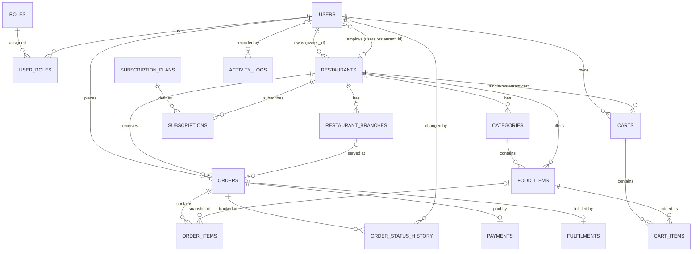

# OmniEats — Database Design

Multi-Restaurant Food Ordering SaaS Platform · TAR UMT AMCS2194
Version 0.1 (draft for team approval) · 2026-11-05

Source of truth for the physical schema: [`database/schema.sql`](../database/schema.sql).
**The ERD below, this data dictionary, and the SQL file must stay in sync.** When a table
changes, all three are updated together.

---

## 1. Design Principles & Conventions

1. **Shared database, tenant isolation.** All restaurants share one MySQL database.
   Every restaurant-owned record carries a `restaurant_id` foreign key, and every
   protected query filters by the tenant derived from the authenticated session.
2. **Normalised to 3NF**, with one deliberate, documented tenant reference (see §6).
3. **Naming conventions:** tables plural snake_case; PK `id INT UNSIGNED AUTO_INCREMENT`;
   FK `<table>_id`; constraint names `fk_<table>_<reference>`, `uq_*` unique, `idx_*` index.
4. **Monetary values:** `DECIMAL(10,2)` (or `DECIMAL(8,2)` for food prices) — never FLOAT.
5. **Composite keys** where they model identity: `user_roles(user_id, role_id)`,
   `cart_items(cart_id, food_item_id)`.
6. **Soft deletion & audit:**
   - users: `is_active` flag (accounts are never hard-deleted while referenced by history);
   - restaurants: `status = 'deactivated'` (archived, not deleted);
   - subscription plans: `is_active` (archived, not deleted);
   - payments: completed financial records are **never** physically deleted — they are
     `void`-ed; only `pending`/`failed` test records may be deleted.
   - subscription rows are never deleted (history preserved; end state = `cancelled`/`expired`).
7. **Historical snapshots:** `order_items` stores `food_name` + `unit_price` at purchase
   time; `subscriptions` stores `plan_name` + `price_paid`; `fulfilments` stores the
   delivery address used at order time.
8. **Referential integrity:** InnoDB with real foreign keys; `ON DELETE CASCADE` for
   dependent child rows, `RESTRICT` where history must be protected, `SET NULL` where a
   snapshot must survive the parent's deletion.
9. **Status values** are documented constants stored as `VARCHAR` (see §7) and validated
   in PHP — the DB never accepts an unlisted value.

## 2. Entity Relationship Diagram (ERD)



Notes:
- `users` ↔ `restaurants` is a two-way relationship: a user **owns** a restaurant
  (`restaurants.owner_id`), and an owner/staff user **belongs to** a restaurant
  (`users.restaurant_id`, the tenant link). The circular FK is resolved by adding the
  second constraint with `ALTER TABLE` after both tables exist.
- `orders` ↔ `payments` and `orders` ↔ `fulfilments` are **one-to-one** (UNIQUE FK) —
  one payment record and one fulfilment record per order.

## 3. Table List (17 tables)

| # | Table | Purpose | Module |
|---|---|---|---|
| 1 | roles | The four platform roles | M1 |
| 2 | users | All accounts (admin, owners, staff, customers) | M1 |
| 3 | user_roles | Many-to-many user ↔ role assignment (composite PK) | M1 |
| 4 | restaurants | Restaurant tenants, profiles, approval & open status | M2 |
| 5 | restaurant_branches | Branches of each restaurant (plan-limited) | M2 |
| 6 | categories | Food categories per restaurant | M3 |
| 7 | food_items | Menu items with price, image, availability | M3 |
| 8 | subscription_plans | Plan definitions & limits (Free/Basic/Premium) | M4 |
| 9 | subscriptions | Subscription history per restaurant (snapshots) | M4 |
| 10 | carts | One active cart per customer, one restaurant each | M5 |
| 11 | cart_items | Cart lines with quantity | M5 |
| 12 | orders | Customer orders with totals and status | M5 |
| 13 | order_items | Order lines — historical name/price snapshots | M5 |
| 14 | order_status_history | Status timeline for live tracking (unique feature) | M5 |
| 15 | payments | Payment records with simulated gateway audit trail | M6 |
| 16 | fulfilments | Delivery / self-pickup execution records | M6 |
| 17 | activity_logs | Platform activity monitoring (supporting table) | M1/Admin |

## 4. Data Dictionary

### roles
| Column | Type | Constraints | Purpose |
|---|---|---|---|
| id | INT UNSIGNED | PK, AI | Role identifier |
| name | VARCHAR(30) | NOT NULL, UNIQUE | `super_admin` \| `restaurant_owner` \| `restaurant_staff` \| `customer` |
| description | VARCHAR(255) | NULL | Human-readable description |
| created_at | DATETIME | NOT NULL | Record creation time |

### users
| Column | Type | Constraints | Purpose |
|---|---|---|---|
| id | INT UNSIGNED | PK, AI | User identifier |
| name | VARCHAR(100) | NOT NULL | Display name |
| email | VARCHAR(191) | NOT NULL, UNIQUE | Login identity |
| password_hash | VARCHAR(255) | NOT NULL | `password_hash()` output — never sent to the frontend |
| phone | VARCHAR(20) | NULL | Contact number |
| restaurant_id | INT UNSIGNED | NULL, FK → restaurants (SET NULL) | Tenant link for owner/staff accounts |
| is_active | TINYINT(1) | NOT NULL, DEFAULT 1 | 0 = deactivated (soft delete) |
| created_at / updated_at | DATETIME | NOT NULL | Timestamps |

### user_roles
| Column | Type | Constraints | Purpose |
|---|---|---|---|
| user_id | INT UNSIGNED | PK, FK → users (CASCADE) | Assigned user |
| role_id | INT UNSIGNED | PK, FK → roles (CASCADE) | Assigned role |
| created_at | DATETIME | NOT NULL | Timestamp |

### restaurants
| Column | Type | Constraints | Purpose |
|---|---|---|---|
| id | INT UNSIGNED | PK, AI | Restaurant (tenant) identifier |
| owner_id | INT UNSIGNED | NOT NULL, FK → users (RESTRICT) | Owning account |
| name | VARCHAR(100) | NOT NULL | Restaurant name |
| slug | VARCHAR(120) | NOT NULL, UNIQUE | URL-friendly public identifier |
| description | TEXT | NULL | Public description |
| logo / cover_image | VARCHAR(255) | NULL | Uploaded image paths |
| phone / email | VARCHAR(20)/(191) | NULL | Public contact details |
| address / city / state / postcode | VARCHAR | NULL | Physical address |
| opening_hours | VARCHAR(255) | NULL | e.g. `Mon-Sun 10:00 - 22:00` |
| is_open | TINYINT(1) | NOT NULL, DEFAULT 1 | ★ Availability control: 1 open, 0 closed |
| status | VARCHAR(20) | NOT NULL, DEFAULT 'pending' | `pending` \| `approved` \| `deactivated` |
| created_at / updated_at | DATETIME | NOT NULL | Timestamps |

### restaurant_branches
| Column | Type | Constraints | Purpose |
|---|---|---|---|
| id | INT UNSIGNED | PK, AI | Branch identifier |
| restaurant_id | INT UNSIGNED | NOT NULL, FK → restaurants (CASCADE) | Tenant |
| name | VARCHAR(100) | NOT NULL | Branch name |
| address / phone | VARCHAR | NULL | Branch contact |
| opening_hours | VARCHAR(255) | NULL | Branch-specific hours |
| is_main | TINYINT(1) | NOT NULL, DEFAULT 0 | Main branch flag |
| is_active | TINYINT(1) | NOT NULL, DEFAULT 1 | Branch enabled flag |
| created_at / updated_at | DATETIME | NOT NULL | Timestamps |

### categories
| Column | Type | Constraints | Purpose |
|---|---|---|---|
| id | INT UNSIGNED | PK, AI | Category identifier |
| restaurant_id | INT UNSIGNED | NOT NULL, FK → restaurants (CASCADE) | Tenant |
| name | VARCHAR(100) | NOT NULL, UNIQUE(restaurant_id, name) | Category name (unique per restaurant) |
| description | VARCHAR(255) | NULL | Category description |
| sort_order | INT | NOT NULL, DEFAULT 0 | Menu display order |
| created_at | DATETIME | NOT NULL | Timestamp |

### food_items
| Column | Type | Constraints | Purpose |
|---|---|---|---|
| id | INT UNSIGNED | PK, AI | Food item identifier |
| restaurant_id | INT UNSIGNED | NOT NULL, FK → restaurants (CASCADE) | Tenant reference (must equal category's restaurant) |
| category_id | INT UNSIGNED | NOT NULL, FK → categories (RESTRICT) | Parent category — blocks deleting non-empty categories |
| name | VARCHAR(100) | NOT NULL | Food name |
| description | TEXT | NULL | Food description |
| price | DECIMAL(8,2) | NOT NULL, CHECK (price > 0) | Current selling price |
| image | VARCHAR(255) | NULL | Uploaded image path |
| is_available | TINYINT(1) | NOT NULL, DEFAULT 1 | Availability — re-checked at checkout |
| created_at / updated_at | DATETIME | NOT NULL | Timestamps |

### subscription_plans
| Column | Type | Constraints | Purpose |
|---|---|---|---|
| id | INT UNSIGNED | PK, AI | Plan identifier |
| name | VARCHAR(50) | NOT NULL, UNIQUE | Plan name (Free / Basic / Premium) |
| price | DECIMAL(8,2) | NOT NULL, DEFAULT 0.00 | Monthly price (0.00 = free) |
| billing_cycle | VARCHAR(20) | NOT NULL, DEFAULT 'monthly' | Billing period |
| max_branches | INT UNSIGNED | NOT NULL | Branch quota |
| max_food_items | INT UNSIGNED | NULL | Food item quota; NULL = unlimited |
| description | TEXT | NULL | Marketing description |
| features | TEXT | NULL | Feature list (one per line) |
| is_active | TINYINT(1) | NOT NULL, DEFAULT 1 | 0 = archived plan |
| sort_order | INT | NOT NULL, DEFAULT 0 | Display order |
| created_at / updated_at | DATETIME | NOT NULL | Timestamps |

### subscriptions (history preserved)
| Column | Type | Constraints | Purpose |
|---|---|---|---|
| id | INT UNSIGNED | PK, AI | Subscription record identifier |
| restaurant_id | INT UNSIGNED | NOT NULL, FK → restaurants (CASCADE) | Tenant |
| plan_id | INT UNSIGNED | NOT NULL, FK → subscription_plans (RESTRICT) | Chosen plan (history protected) |
| plan_name | VARCHAR(50) | NOT NULL | Plan name snapshot |
| price_paid | DECIMAL(8,2) | NOT NULL | Price paid snapshot |
| starts_at / ends_at | DATETIME | NOT NULL | Validity period |
| status | VARCHAR(20) | NOT NULL, DEFAULT 'active' | `active` \| `expired` \| `cancelled` |
| created_at / updated_at | DATETIME | NOT NULL | Timestamps |

### carts
| Column | Type | Constraints | Purpose |
|---|---|---|---|
| id | INT UNSIGNED | PK, AI | Cart identifier |
| customer_id | INT UNSIGNED | NOT NULL, UNIQUE, FK → users (CASCADE) | One active cart per customer |
| restaurant_id | INT UNSIGNED | NOT NULL, FK → restaurants (CASCADE) | Single-restaurant rule |
| created_at / updated_at | DATETIME | NOT NULL | Timestamps |

### cart_items
| Column | Type | Constraints | Purpose |
|---|---|---|---|
| id | INT UNSIGNED | PK, AI | Cart line identifier |
| cart_id | INT UNSIGNED | NOT NULL, FK → carts (CASCADE) | Parent cart |
| food_item_id | INT UNSIGNED | NOT NULL, FK → food_items (RESTRICT) | Menu item (must be valid) |
| quantity | INT | NOT NULL, DEFAULT 1, CHECK (quantity > 0) | Quantity |
| created_at / updated_at | DATETIME | NOT NULL | Timestamps |

### orders
| Column | Type | Constraints | Purpose |
|---|---|---|---|
| id | INT UNSIGNED | PK, AI | Order identifier |
| order_no | VARCHAR(20) | NOT NULL, UNIQUE | Human-readable number, e.g. `OE-20261105-0001` |
| customer_id | INT UNSIGNED | NOT NULL, FK → users (RESTRICT) | Ordering customer (history protected) |
| restaurant_id | INT UNSIGNED | NOT NULL, FK → restaurants (RESTRICT) | Tenant that receives the order |
| branch_id | INT UNSIGNED | NULL, FK → restaurant_branches (SET NULL) | Serving branch |
| fulfilment_type | VARCHAR(20) | NOT NULL | `delivery` \| `pickup` |
| delivery_address / delivery_phone | VARCHAR | NULL | Snapshot for delivery orders |
| subtotal | DECIMAL(10,2) | NOT NULL | Sum of order items (backend-calculated) |
| delivery_fee | DECIMAL(10,2) | NOT NULL, DEFAULT 0.00 | Fee (0 for pickup) |
| discount | DECIMAL(10,2) | NOT NULL, DEFAULT 0.00 | Promo discount deducted from the total |
| total | DECIMAL(10,2) | NOT NULL | subtotal + delivery_fee − discount |
| status | VARCHAR(30) | NOT NULL, DEFAULT 'pending_payment' | Order status (§7) |
| note | VARCHAR(255) | NULL | Customer note |
| created_at / updated_at | DATETIME | NOT NULL | Timestamps |

### order_items (historical snapshots)
| Column | Type | Constraints | Purpose |
|---|---|---|---|
| id | INT UNSIGNED | PK, AI | Order line identifier |
| order_id | INT UNSIGNED | NOT NULL, FK → orders (CASCADE) | Parent order |
| food_item_id | INT UNSIGNED | NULL, FK → food_items (SET NULL) | Source item; NULL after item deletion |
| food_name | VARCHAR(100) | NOT NULL | ★ Name snapshot at purchase time |
| unit_price | DECIMAL(8,2) | NOT NULL | ★ Price snapshot at purchase time |
| quantity | INT | NOT NULL | Quantity ordered |
| subtotal | DECIMAL(10,2) | NOT NULL | unit_price × quantity |

### order_status_history (live tracking)
| Column | Type | Constraints | Purpose |
|---|---|---|---|
| id | INT UNSIGNED | PK, AI | History row identifier |
| order_id | INT UNSIGNED | NOT NULL, FK → orders (CASCADE) | Tracked order |
| from_status | VARCHAR(30) | NULL | Previous status (NULL for the initial row) |
| to_status | VARCHAR(30) | NOT NULL | New status |
| changed_by | INT UNSIGNED | NULL, FK → users (SET NULL) | User or system (NULL) |
| note | VARCHAR(255) | NULL | Optional reason/note |
| created_at | DATETIME | NOT NULL | When the change happened (timeline order) |

### payments (audit trail)
| Column | Type | Constraints | Purpose |
|---|---|---|---|
| id | INT UNSIGNED | PK, AI | Payment record identifier |
| order_id | INT UNSIGNED | NOT NULL, UNIQUE, FK → orders (CASCADE) | One payment record per order |
| method | VARCHAR(20) | NOT NULL | `cash` \| `online` |
| amount | DECIMAL(10,2) | NOT NULL | Amount charged (= order total) |
| status | VARCHAR(20) | NOT NULL, DEFAULT 'pending' | `pending` \| `success` \| `failed` \| `void` |
| transaction_ref | VARCHAR(64) | NULL | Simulated gateway reference |
| paid_at | DATETIME | NULL | Timestamp of successful payment |
| created_at / updated_at | DATETIME | NOT NULL | Timestamps |

### fulfilments
| Column | Type | Constraints | Purpose |
|---|---|---|---|
| id | INT UNSIGNED | PK, AI | Fulfilment record identifier |
| order_id | INT UNSIGNED | NOT NULL, UNIQUE, FK → orders (CASCADE) | One fulfilment record per order |
| type | VARCHAR(20) | NOT NULL | `delivery` \| `pickup` |
| address / phone | VARCHAR | NULL | Delivery snapshot |
| status | VARCHAR(30) | NOT NULL, DEFAULT 'pending' | `pending` \| `out_for_delivery` \| `ready_for_collection` \| `completed` \| `cancelled` |
| completed_at | DATETIME | NULL | Completion timestamp |
| created_at / updated_at | DATETIME | NOT NULL | Timestamps |

### activity_logs (supporting table)
| Column | Type | Constraints | Purpose |
|---|---|---|---|
| id | INT UNSIGNED | PK, AI | Log entry identifier |
| user_id | INT UNSIGNED | NULL, FK → users (SET NULL) | Actor (NULL = guest/system) |
| action | VARCHAR(50) | NOT NULL | e.g. `login`, `create_food_item`, `approve_restaurant` |
| entity / entity_id | VARCHAR(50) / INT UNSIGNED | NULL | Affected record |
| details | TEXT | NULL | Additional context |
| ip_address | VARCHAR(45) | NULL | Actor IP |
| created_at | DATETIME | NOT NULL | Timestamp (indexed) |

## 5. Relationship Explanations

| Relationship | Cardinality | Business meaning |
|---|---|---|
| roles ↔ user_roles ↔ users | M : N | A user can hold more than one role (e.g. owner of their restaurant); composite PK prevents duplicates |
| users → restaurants (owner_id) | 1 : N | Each restaurant has exactly one owner account; owners cannot be deleted while owning a restaurant (RESTRICT) |
| restaurants → users (restaurant_id) | 1 : N | Tenant membership for owner/staff; NULL for admins and customers |
| restaurants → restaurant_branches | 1 : N | Branches belong to one tenant; deleting a restaurant deletes its branches |
| restaurants → categories → food_items | 1 : N : N | Menu hierarchy; a category with items cannot be deleted (RESTRICT) until emptied |
| restaurants → food_items | 1 : N | Direct tenant reference on items (see §6 for the 3NF discussion) |
| subscription_plans → subscriptions | 1 : N | Plans are never hard-deleted once used (RESTRICT); every subscription keeps plan/price snapshots |
| restaurants → subscriptions | 1 : N | A restaurant's subscription history; rows are never deleted |
| users → carts (customer) | 1 : 1 | UNIQUE(customer_id): one active cart per customer |
| restaurants → carts | 1 : N | The cart's single restaurant — enforced in the service layer as well |
| carts → cart_items → food_items | 1 : N : 1 | Cart lines always reference valid food items (RESTRICT) |
| users → orders (customer) / restaurants → orders | N : N via two FKs | Every order names its customer AND its receiving tenant |
| orders → order_items | 1 : N | Snapshot lines survive food item deletion (SET NULL on food_item_id) |
| orders → order_status_history | 1 : N | DB-backed timeline for the live tracking feature |
| orders → payments / orders → fulfilments | 1 : 1 | One payment and one fulfilment record per order (UNIQUE FKs) |
| users → activity_logs | 1 : N | Platform monitoring; logs survive user deletion (SET NULL) |

**Tenant isolation pattern (enforced in PHP, guaranteed by schema):**
the authenticated session gives us `user_id`; the user's `restaurant_id` (for owner/staff)
or the record's `customer_id` (for customers) determines the tenant. Controllers therefore
query with `WHERE restaurant_id = :tenant_id` (or `customer_id = :user_id`) using the
**session-derived value only** — never a POST value. Cross-tenant tests in the test plan
verify this.

## 6. 3NF Explanation

**First Normal Form (1NF):** every column is atomic — no repeating groups. Feature lists
on plans are stored as one TEXT blob (never queried), which keeps 1NF in the relational
sense (a single value per cell).

**Second Normal Form (2NF):** every non-key column depends on the *whole* primary key.
In composite-key tables, `user_roles` holds only assignment metadata, and
`cart_items.quantity` depends on the full (cart_id, food_item_id) pair — satisfied.

**Third Normal Form (3NF):** no transitive dependencies. Examples:
- `food_items` stores price once; `order_items` copies it **as a snapshot** — a snapshot
  is not a transitive dependency, it is time-captured history (removing it would break
  the business rule "historical order items must preserve their original name and price").
- `subscriptions` stores `plan_name`/`price_paid` snapshots for the same reason — the
  plan row may later change price or be archived, but history must not change.
- `orders.total` is derived (subtotal + fee). It is stored because it is a **business
  fact at order time** (a receipt), not a live computation.

**One deliberate deviation, documented:** `food_items` and `orders` carry a direct
`restaurant_id` although the category/cart relationship would let it be derived. This is
a **tenant reference** for multi-tenant isolation: it lets every tenant-scoped query use
one indexed column without multi-table joins, and the two FKs are verified to agree when
records are written. This is the standard pattern for shared-database SaaS and is called
out here so the diagrams, dictionary and code stay consistent.

## 7. Status & Enumeration Values

| Field | Allowed values |
|---|---|
| users.is_active | 0 (deactivated), 1 (active) |
| restaurants.status | pending → approved; deactivated (terminal-ish, admin can reactivate) |
| restaurants.is_open | 0 (CLOSED — orders blocked), 1 (OPEN) |
| subscriptions.status | active → expired (auto, when ends_at passes) or cancelled (manual); active → cancelled |
| orders.status | pending_payment → confirmed → preparing → ready → completed; any of pending_payment/confirmed/preparing/ready → cancelled; completed/cancelled are terminal |
| payments.status | pending → success or failed; pending/failed → void; success → void (audit only, order remains paid history) |
| payments.method | cash, online |
| fulfilments.type | delivery, pickup |
| fulfilments.status | pending → out_for_delivery (delivery) or ready_for_collection (pickup) → completed; pending → cancelled |

The order transition map is enforced in `OrderService::transition()` and every change is
written to `order_status_history`.

## 8. Installation (Phase 3)

```bash
# via phpMyAdmin → SQL tab, or command line:
mysql -u root < database/schema.sql
mysql -u root < database/seed.sql
```

Seed password hashes are generated with:
`php -r "echo password_hash('Password@123', PASSWORD_DEFAULT);"` and pasted into `seed.sql`.

## 9. Seed Data Summary

| Item | Content |
|---|---|
| Roles | super_admin, restaurant_owner, restaurant_staff, customer |
| Plans | Free (RM0, 1 branch, 10 items) · Basic (RM49.90, 3 branches, 50 items) · Premium (RM129.90, 10 branches, unlimited) |
| Accounts | superadmin@omnieats.com · two restaurant owners · one staff · two customers (all `Password@123`) |
| Restaurants | Nasi Lemak House (approved, OPEN, Premium active) · Pizza & Pasta Corner (approved, **CLOSED** to demo the availability feature, Free plan **expired** to demo auto-expiry) |
| Menus | Branches, categories and food items for both restaurants |
