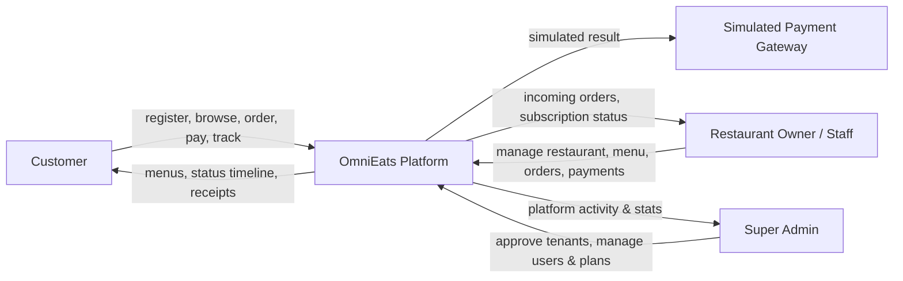
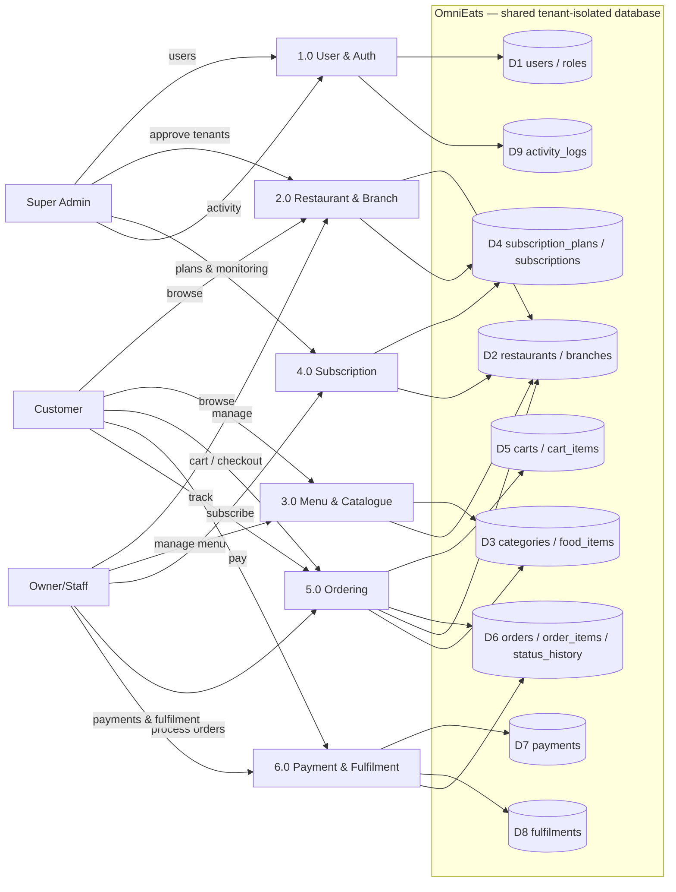

# OmniEats — Data Flow Diagrams

TAR UMT AMCS2194 · Chapter 2 material · matches the implemented system

## 1. Context Diagram (Level 0)

External entities: **Customer**, **Restaurant Owner/Staff**, **Super Admin**, and the
**Simulated Payment Gateway** (internal component — no real third party).

## 2. DFD Level 0 (system processes)

Process notes (implemented in code):
- **1.0** `AuthService`, `UserService`, `UserController`, `RegisterController`, `ProfileController`
- **2.0** `RestaurantService`, `BranchService`, owner/admin restaurant controllers
- **3.0** `CategoryService`, `FoodItemService` (+ `UploadService`)
- **4.0** `SubscriptionService` (★ auto-expiry + quota), `PlanService`
- **5.0** `CartService`, `OrderService` (★ validated transitions + status history)
- **6.0** `PaymentService` (simulated gateway), `FulfilmentService`

Every process reads/writes through PDO prepared statements; tenant isolation is
enforced in the application layer using the session-derived `restaurant_id`.
