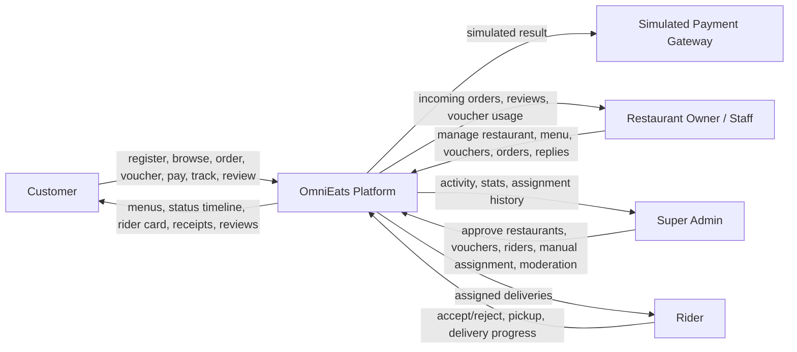
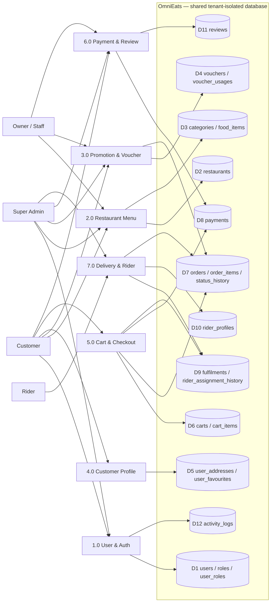
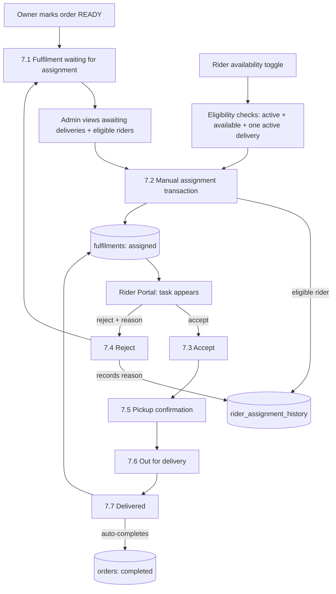

# OmniEats — Data Flow Diagrams

TAR UMT AMCS2194 · Chapter 2 material · matches the implemented system
Four roles, six modules, one shared tenant-isolated database.

## 1. Context Diagram (Level 0)

External entities: **Customer**, **Restaurant Owner/Staff**, **Super Admin**,
**Rider**, and the **Simulated Payment Gateway** (internal component — no real
third party).

## 2. DFD Level 0 (system processes)

Note: processes 1–7 are the shared system functions implementing the SIX
modules (auth/cart are the shared plumbing of the six CRUD modules).

## 3. DFD Level 1 — Delivery & Rider Management (7.0)

The assignment is ALWAYS admin-initiated (manual) — riders never claim tasks,
and every attempt is preserved in the assignment history.
